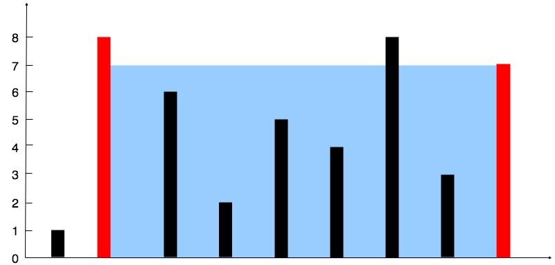

# 1. Container With Most Water

- LeetCode #11 · Medium
- Implement `Solution.MaxArea` in `Solution.cs`, then run `P001_ContainerWithMostWaterTests`.

## Problem

`height[i]` is the height of the i-th vertical line, drawn at x = i from y = 0 up to y = `height[i]`.
Pick two lines; together with the x-axis they form a container. Return the largest amount of water such a
container can hold. The container cannot be tilted.

## Examples

**Example 1**



```text
Input:  height = [1,8,6,2,5,4,8,3,7]
Output: 49
```

The best pair is the lines of height 8 (index 1) and 7 (index 8): min(8, 7) * (8 - 1) = 49.

**Example 2**

```text
Input:  height = [1,1]
Output: 1
```

## Constraints

- `n == height.length`
- `2 <= n <= 10^5`
- `0 <= height[i] <= 10^4`

## Signature

```csharp
public int MaxArea(int[] height)
```

## Run

```text
dotnet test --filter "FullyQualifiedName~P001_ContainerWithMostWater"
```
