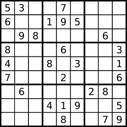

# 3. Valid Sudoku

- LeetCode #36 · Medium
- Implement `Solution.IsValidSudoku` in `Solution.cs`, then run `P003_ValidSudokuTests`.

## Problem

Decide whether a partially filled 9 x 9 Sudoku board is valid. Only the filled cells are checked, against these rules:

1. Each row contains the digits 1-9 at most once.
2. Each column contains the digits 1-9 at most once.
3. Each of the nine 3 x 3 sub-boxes contains the digits 1-9 at most once.

A board can be valid without being solvable. Empty cells are the character `'.'`.

## Examples

**Example 1**



```text
Input:  board = [["5","3",".",".","7",".",".",".","."],["6",".",".","1","9","5",".",".","."],[".","9","8",".",".",".",".","6","."],["8",".",".",".","6",".",".",".","3"],["4",".",".","8",".","3",".",".","1"],["7",".",".",".","2",".",".",".","6"],[".","6",".",".",".",".","2","8","."],[".",".",".","4","1","9",".",".","5"],[".",".",".",".","8",".",".","7","9"]]
Output: true
```

**Example 2**

```text
Input:  board = [["8","3",".",".","7",".",".",".","."],["6",".",".","1","9","5",".",".","."],[".","9","8",".",".",".",".","6","."],["8",".",".",".","6",".",".",".","3"],["4",".",".","8",".","3",".",".","1"],["7",".",".",".","2",".",".",".","6"],[".","6",".",".",".",".","2","8","."],[".",".",".","4","1","9",".",".","5"],[".",".",".",".","8",".",".","7","9"]]
Output: false
```

Same as example 1 except the top-left 5 became an 8. There are now two 8s in the top-left 3x3 box.

## Constraints

- `board.length == 9`
- `board[i].length == 9`
- `board[i][j]` is a digit `'1'`-`'9'` or `'.'`

## Signature

```csharp
public bool IsValidSudoku(char[][] board)
```

## Run

```text
dotnet test --filter "FullyQualifiedName~P003_ValidSudoku"
```
