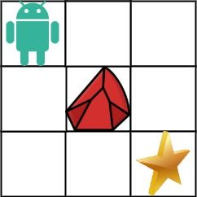

# 8. Unique Paths II

- LeetCode #63 · Medium
- Implement `Solution.UniquePathsWithObstacles` in `Solution.cs`, then run `P008_UniquePathsIITests`.

## Problem

A robot starts at the top-left cell of an `m x n` grid and wants to reach the bottom-right cell. It can only move
down or right. A cell containing `1` is an obstacle and cannot be entered; `0` is free.
Return the number of distinct paths the robot can take.

The answer is guaranteed to be at most `2 * 10^9`.

## Examples

**Example 1**



```text
Input:  obstacleGrid = [[0,0,0],[0,1,0],[0,0,0]]
Output: 2
```

There is one obstacle in the middle of the 3x3 grid, giving two paths: right-right-down-down and down-down-right-right.

**Example 2**


```text
Input:  obstacleGrid = [[0,1],[0,0]]
Output: 1
```

## Constraints

- `m == obstacleGrid.length`
- `n == obstacleGrid[i].length`
- `1 <= m, n <= 100`
- `obstacleGrid[i][j]` is `0` or `1`

## Signature

```csharp
public int UniquePathsWithObstacles(int[][] obstacleGrid)
```

## Run

```text
dotnet test --filter "FullyQualifiedName~P008_UniquePathsII"
```
