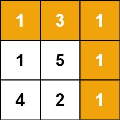

# 9. Minimum Path Sum

- LeetCode #64 · Medium
- Implement `Solution.MinPathSum` in `Solution.cs`, then run `P009_MinimumPathSumTests`.

## Problem

Given an `m x n` grid of non-negative numbers, find a path from the top-left to the bottom-right cell that
minimises the sum of the numbers along the path. You may only move down or right.

## Examples

**Example 1**



```text
Input:  grid = [[1,3,1],[1,5,1],[4,2,1]]
Output: 7
```

The path 1 -> 3 -> 1 -> 1 -> 1 minimises the sum.

**Example 2**

```text
Input:  grid = [[1,2,3],[4,5,6]]
Output: 12
```

## Constraints

- `m == grid.length`
- `n == grid[i].length`
- `1 <= m, n <= 200`
- `0 <= grid[i][j] <= 200`

## Signature

```csharp
public int MinPathSum(int[][] grid)
```

## Run

```text
dotnet test --filter "FullyQualifiedName~P009_MinimumPathSum"
```
