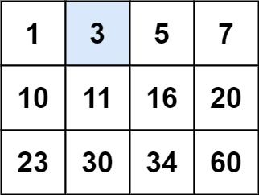
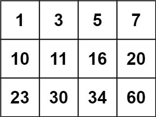

# 10. Search a 2D Matrix

- LeetCode #74 · Medium
- Implement `Solution.SearchMatrix` in `Solution.cs`, then run `P010_SearchA2DMatrixTests`.

## Problem

`matrix` is an `m x n` integer matrix where each row is sorted in non-decreasing order and the first value of each
row is greater than the last value of the previous row. Return `true` if `target` is in the matrix, `false` otherwise.

The solution must run in O(log(m * n)) time.

## Examples

**Example 1**



```text
Input:  matrix = [[1,3,5,7],[10,11,16,20],[23,30,34,60]], target = 3
Output: true
```

**Example 2**



```text
Input:  matrix = [[1,3,5,7],[10,11,16,20],[23,30,34,60]], target = 13
Output: false
```

## Constraints

- `m == matrix.length`
- `n == matrix[i].length`
- `1 <= m, n <= 100`
- `-10^4 <= matrix[i][j], target <= 10^4`

## Signature

```csharp
public bool SearchMatrix(int[][] matrix, int target)
```

## Run

```text
dotnet test --filter "FullyQualifiedName~P010_SearchA2DMatrix"
```
