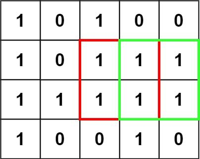
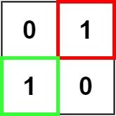

# 20. Maximal Square

- LeetCode #221 · Medium
- Implement `Solution.MaximalSquare` in `Solution.cs`, then run `P020_MaximalSquareTests`.

## Problem

Given an `m x n` binary matrix of characters `'0'` and `'1'`, find the largest square that contains only `'1'` and
return its **area**.

## Examples

**Example 1**



```text
Input:  matrix = [["1","0","1","0","0"],["1","0","1","1","1"],["1","1","1","1","1"],["1","0","0","1","0"]]
Output: 4
```

**Example 2**



```text
Input:  matrix = [["0","1"],["1","0"]]
Output: 1
```

**Example 3**

```text
Input:  matrix = [["0"]]
Output: 0
```

## Constraints

- `m == matrix.length`
- `n == matrix[i].length`
- `1 <= m, n <= 300`
- `matrix[i][j]` is `'0'` or `'1'`

## Signature

```csharp
public int MaximalSquare(char[][] matrix)
```

## Run

```text
dotnet test --filter "FullyQualifiedName~P020_MaximalSquare"
```
