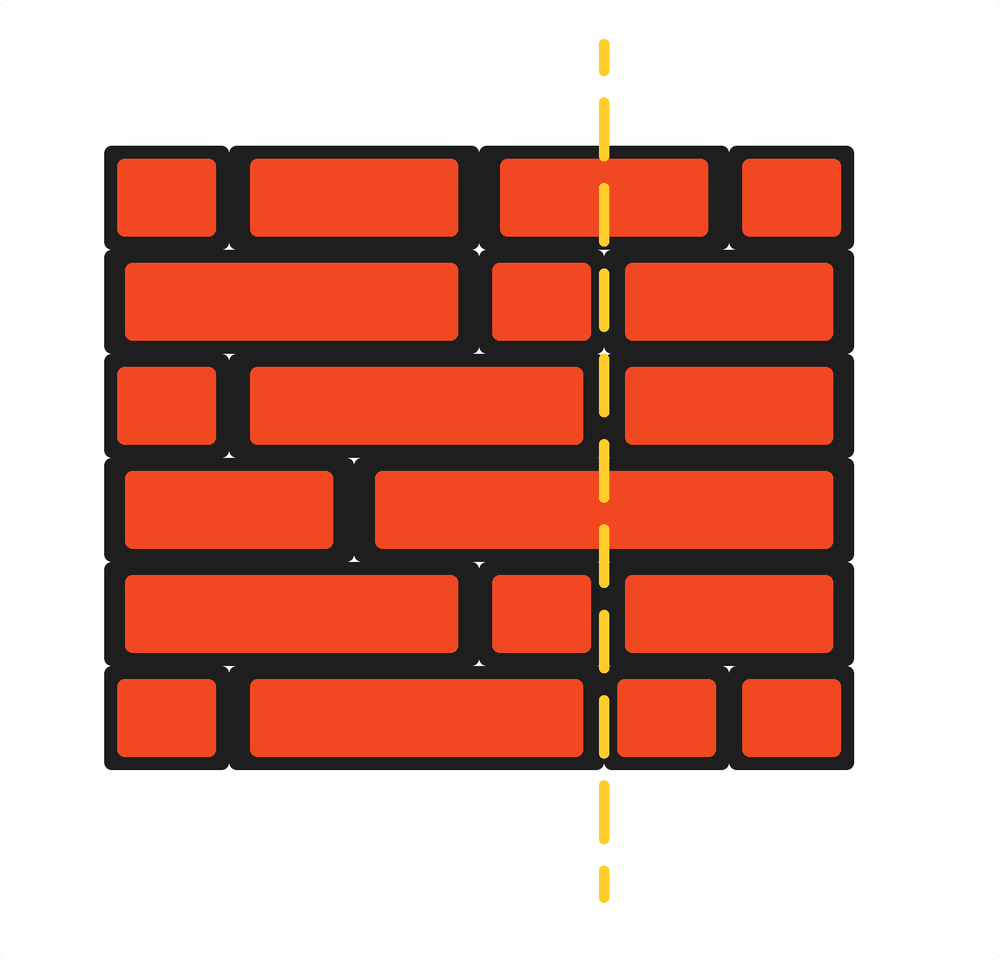

# 34. Brick Wall

- LeetCode #554 · Medium
- Implement `Solution.LeastBricks` in `Solution.cs`, then run `P034_BrickWallTests`.

## Problem

A rectangular wall is made of `n` rows of bricks. All rows have the same total width but the bricks have different widths.
`wall[i]` lists the widths of the bricks in row `i`, left to right.

Draw a vertical line from top to bottom. A brick that the line only touches along its edge is not crossed. Return the
minimum number of bricks the line must cross. The line cannot run along the outer left or right edge of the wall (that would
cross zero bricks).

In C# the wall is passed as `int[][]`.

## Examples

**Example 1**



```text
Input:  wall = [[1,2,2,1],[3,1,2],[1,3,2],[2,4],[3,1,2],[1,3,1,1]]
Output: 2
```

Drawing the line at x = 4 crosses two bricks.

**Example 2**

```text
Input:  wall = [[1],[1],[1]]
Output: 3
```

Every row has a single brick, so any line crosses all three rows.

## Constraints

- `n == wall.length`
- `1 <= n <= 10^4`
- `1 <= wall[i].length <= 10^4`
- `1 <= sum(wall[i].length) <= 2 * 10^4`
- `sum(wall[i])` is the same for every row `i`
- `1 <= wall[i][j] <= 2^31 - 1`

## Signature

```csharp
public int LeastBricks(int[][] wall)
```

## Run

```text
dotnet test --filter "FullyQualifiedName~P034_BrickWall"
```
