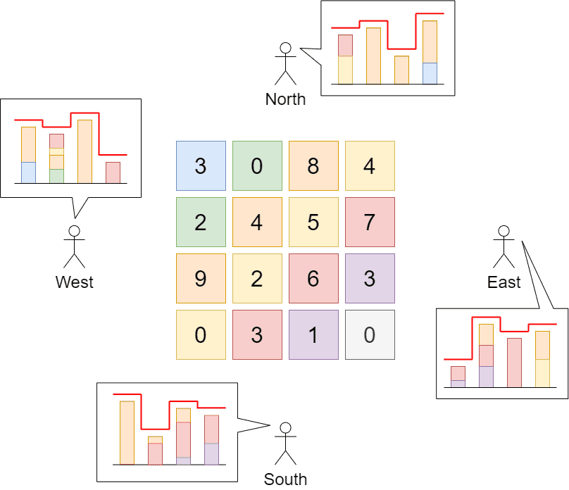

# 39. Max Increase to Keep City Skyline

- LeetCode #807 · Medium
- Implement `Solution.MaxIncreaseKeepingSkyline` in `Solution.cs`, then run `P039_MaxIncreaseToKeepCitySkylineTests`.

## Problem

A city is an `n x n` grid of blocks; `grid[r][c]` is the height of the building in that block. The skyline seen from each
of the four directions (north, east, south, west) is the outline of the tallest buildings in each row/column.

You may raise any number of buildings by any amount (zero-height buildings too), as long as no skyline changes.
Return the maximum total height that can be added.

## Examples

**Example 1**



```text
Input:  grid = [[3,0,8,4],[2,4,5,7],[9,2,6,3],[0,3,1,0]]
Output: 35
```

The grid can become [[8,4,8,7],[7,4,7,7],[9,4,8,7],[3,3,3,3]]; the total increase is 35.

**Example 2**

```text
Input:  grid = [[0,0,0],[0,0,0],[0,0,0]]
Output: 0
```

## Constraints

- `n == grid.length`
- `n == grid[r].length`
- `2 <= n <= 50`
- `0 <= grid[r][c] <= 100`

## Signature

```csharp
public int MaxIncreaseKeepingSkyline(int[][] grid)
```

## Run

```text
dotnet test --filter "FullyQualifiedName~P039_MaxIncreaseToKeepCitySkyline"
```
