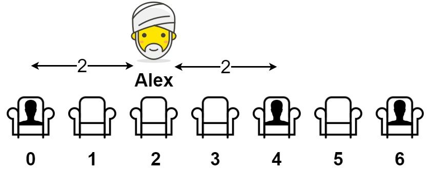

# 41. Maximize Distance to Closest Person

- LeetCode #849 · Medium
- Implement `Solution.MaxDistToClosest` in `Solution.cs`, then run `P041_MaximizeDistanceToClosestPersonTests`.

## Problem

`seats[i] = 1` means seat `i` is taken and `seats[i] = 0` means it is empty. There is at least one empty and one
occupied seat. Alex wants to sit in an empty seat so that the distance to the closest person is as large as possible.
Return that maximum distance.

## Examples

**Example 1**



```text
Input:  seats = [1,0,0,0,1,0,1]
Output: 2
```

Alex sits in seats[2]; the closest person is 2 seats away. Any other empty seat is only 1 away.

**Example 2**

```text
Input:  seats = [1,0,0,0]
Output: 3
```

Alex sits in the last seat, 3 seats away from the only person.

**Example 3**

```text
Input:  seats = [0,1]
Output: 1
```

## Constraints

- `2 <= seats.length <= 2 * 10^4`
- `seats[i]` is `0` or `1`
- At least one seat is empty
- At least one seat is occupied

## Signature

```csharp
public int MaxDistToClosest(int[] seats)
```

## Run

```text
dotnet test --filter "FullyQualifiedName~P041_MaximizeDistanceToClosestPerson"
```
